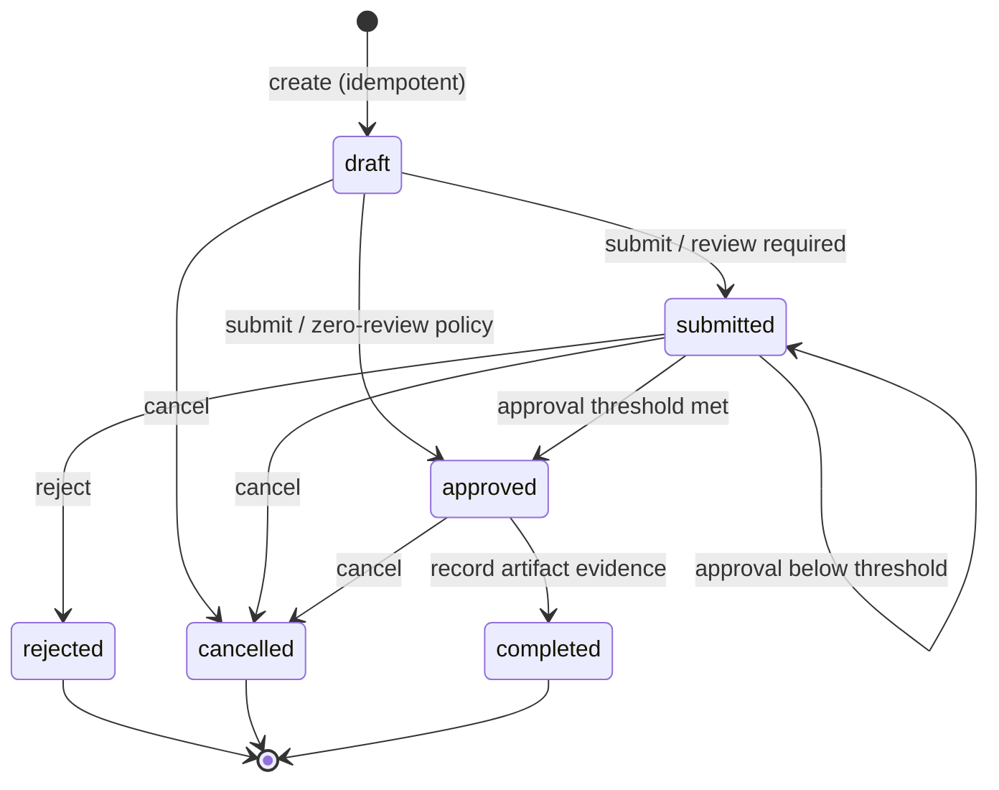

# ShipGate Control Plane

**A tenant-isolated, policy-driven release approval and deployment-evidence API.**

ShipGate solves a common operational gap: a deployment can have a passing CI job yet lack
traceable authorization, separation of duties, the exact approved artifact digest, or evidence
of what happened afterward. It manages **release decisions**, not the actual deployment.

**Status:** functional v0.3 reference implementation. Automated integration tests pass on
SQLite. PostgreSQL migrations and integration coverage are included in CI but were not run in
the original offline development environment. It has **not** been deployed to a production
cluster, penetration tested, or load tested; do not mistake code completeness for operational
qualification. See [security](docs/SECURITY.md) and [release checklist](docs/OPERATIONS.md).

## What it does

- **Multi-tenant isolation:** all project, release, key, and audit API queries are scoped to
  the authenticated tenant; composite foreign keys reinforce boundary consistency.
- **Least-privilege API keys:** one-time plaintext token issuance, SHA-256 secret digests,
  configurable 1–2160 hour expiry, transactional rotation and revocation, and
  `admin`, `operator`, `approver`, and `auditor` roles.
- **Versioned project policies:** baseline release safety floors plus tenant-isolated,
  admin-managed per-environment/risk approval quorums (0–5). Optimistic concurrency
  prevents lost updates, and each release snapshots the effective policy and version.
- **Separation of duties:** the author of a change cannot review it; a reviewer cannot vote
  twice; administrators can revoke compromised keys.
- **Optimistic concurrency:** every release mutation requires an `expected_version`.
  PostgreSQL row locks serialize decisions, and a per-idempotency-key advisory lock
  serializes concurrent retries.
- **Idempotent creation:** repeat a release creation request with the same key and payload
  without duplicating release or audit records. A changed body with the same key is rejected.
- **Tamper-detection chain:** SHA-256-linked append-only *application* audit events, a
  per-tenant head, verification endpoint, and CLI. For durable independent proof, anchor
  the head externally (see security notes).
- **Deployment evidence:** an approved release can be marked completed only when the
  observed artifact SHA-256 matches the approved digest and an HTTPS evidence URL is given.
  This records a claim from a trusted actor, **not** independent verification of a deployment.
- **Operational packaging:** PostgreSQL, Alembic migrations, non-root multi-stage Docker,
  health endpoints, GitHub Actions, OpenAPI, API tests, and role-aware CLI.

## Lifecycle



## Run locally (SQLite development mode)

Requires Python 3.11+ and a network connection to install dependencies.

```bash
python -m venv .venv
source .venv/bin/activate
pip install -e '.[dev]'
cp .env.example .env
alembic upgrade head
shipgate bootstrap --tenant demo-team --label primary-admin
# Copy the key from the one-time output to a secret manager.
uvicorn shipgate.api:app --host 127.0.0.1 --port 8000
```

In a **new terminal**, set `API_KEY` from the one-time bootstrap output without placing it
in version control or recorded shell history, then try:

```bash
curl -H "X-API-Key: $API_KEY" http://127.0.0.1:8000/v1/me
curl -X POST http://127.0.0.1:8000/v1/projects \
  -H "X-API-Key: $API_KEY" -H 'Content-Type: application/json' \
  -d '{"slug":"payments-api","description":"Payment service"}'
```

Open <http://127.0.0.1:8000/docs> for local Swagger UI and the complete request schemas.
Use [API walkthrough](docs/API_EXAMPLES.md) for a production two-approver release.

## Docker Compose development / staging

Requires Docker and Compose. Supply a **unique** password and a matching URL. Do not put
secrets into `compose.yaml` or commit your shell environment.

```bash
export POSTGRES_PASSWORD='<random-password>'
export SHIPGATE_DATABASE_URL='postgresql+psycopg://shipgate:<url-encoded-password>@db:5432/shipgate'
docker compose up --build -d
# Provision once (prints a one-time key):
docker compose exec -T api shipgate bootstrap --tenant demo-team --label primary-admin
```

The Compose network does not publish the database. The API is bound to the loopback
interface on port 8000. The `migrate` service runs before the API starts; it is **not**
run automatically on every worker startup.

For real deployment: set `SHIPGATE_ENVIRONMENT=production`, an explicitly allowed Host
list, TLS termination with a trustworthy proxy, managed PostgreSQL with backups,
centralized secret storage, rate limits and egress/firewall policies. The included Compose
file is a single-node reference, not a highly available production topology.

## Project structure

| Directory | Responsibility |
|---|---|
| `shipgate/api.py` | HTTP routes, authentication dependency, request limits, health |
| `shipgate/service.py` | Release state machine, policy and transactional decisions |
| `shipgate/security.py` | API key provisioning, verification, role enforcement |
| `shipgate/audit.py` | Per-tenant hash chain and verification |
| `shipgate/models.py` | Tenant-scoped SQLAlchemy schema and integrity constraints |
| `shipgate/cli.py` | One-time tenant bootstrap and audit validation |
| `alembic/versions` | Versioned schema migrations |
| `tests` | API, policy, isolation, audit and PostgreSQL integration tests |
| `docs` | Architecture, operations, risks, decisions and backlog |

## Testing

```bash
pytest -q --cov=shipgate --cov-report=term-missing
ruff check .
python -m compileall -q shipgate alembic tests
```

`tests/test_postgres.py` uses `SHIPGATE_TEST_POSTGRES_URL` and is skipped when a PostgreSQL
instance is unavailable. The CI pipeline provides PostgreSQL and runs this test.

## v0.2 key lifecycle

Newly issued API keys expire after 720 hours by default. Supply `ttl_hours` (1–2160)
to `POST /v1/keys`. To rotate a key atomically, send `POST /v1/keys/{key_id}/rotate`
with `{ "ttl_hours": 720 }` as an admin. The old key is revoked at commit, while the
replacement plaintext secret is shown exactly once. Audit events never contain secrets.
The nullable Alembic migration preserves older keys until their operator-initiated rotation.
See [ADR-0002](docs/ADR_0002_KEY_LIFECYCLE.md).

## v0.3 project-level approval policies

Administrators can tighten approval quorum for a given project, environment, and risk
without weakening non-negotiable platform floors. Existing releases **retain** their
original required approval threshold and policy version. This gives auditors stable
evidence of the decision rules used when a release was created.

```bash
# Review all nine combinations; read-only access permitted for project members.
curl -H "X-API-Key: $API_KEY" \
  http://127.0.0.1:8000/v1/projects/$PROJECT_ID/policies

# As an admin, require three distinct approvals for high-risk production.
curl -X PUT \
  "http://127.0.0.1:8000/v1/projects/$PROJECT_ID/policies/production/high" \
  -H "X-API-Key: $API_KEY" -H 'Content-Type: application/json' \
  -d '{"min_approvals":3,"expected_version":0}'
```

The first override uses `expected_version: 0` and creates version 1. Subsequent updates
pass the current version; stale writes return HTTP 409. Values below the platform floor
return HTTP 422, writes from non-admin roles return HTTP 403, and cross-tenant projects
return HTTP 404. Updates appear in the tenant's tamper-detection audit chain.
See [ADR-0003](docs/ADR_0003_VERSIONED_PROJECT_POLICIES.md), the [interview walkthrough](docs/INTERVIEW_DEMO.md), and the [changelog](CHANGELOG.md).

## Next product milestones

This is an **actively extensible** product, with concrete work in [ROADMAP](docs/ROADMAP.md):
OIDC / SSO for human approvals, GitHub Actions artifact evidence validation, GitOps adapters,
policy-as-code with signed rule versions, webhook notifications, rate limiting and an operator
UI. These are **not** implemented in v0.3.

## Ownership and distribution

Developed as an independent original project. No code or assets from other private user
repositories were copied. This repository contains no API secrets or user data. Source is
provided for review; **no general redistribution license is granted** until the owner
chooses one. If publishing publicly, review `docs/SECURITY.md` and scrub any local build
artifacts first.
