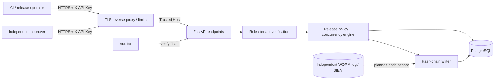

# Architecture and security boundaries

## Data model

- `tenants`: immutable tenant identity and slug.
- `api_keys`: key prefix, SHA-256 secret hash, tenant, role and revocation state.
- `projects`: unique slug within a tenant.
- `releases`: proposed artifact, environment, risk, author, status, version, approval policy.
- `approvals`: unique `(release, reviewer)` and explicit decision.
- `idempotency_records`: per-actor token request fingerprint and release reference.
- `audit_heads`: sequence and chain head, one row per tenant.
- `audit_events`: SHA-256-chain events with canonical JSON and atomic timestamps.

Every mutation joins the authentication tenant to the target data. Composite foreign keys
also reject inconsistent cross-tenant assignments for releases and approval/idempotency
records. Audit and key data is never returned to users from another tenant.

## Transaction boundaries and concurrency

For one request, the database session begins when handling starts and commits after
successful dependency resolution. Exceptions roll back the whole unit. The release row is
locked for transitions (`SELECT FOR UPDATE`) in PostgreSQL; version checks are performed
under that lock. A tenant audit head is separately locked, so unrelated releases in the
same tenant append an ordered chain. Idempotent creation obtains a transaction-scoped
PostgreSQL advisory lock derived from tenant, principal and idempotency key, then checks
its uniqueness constraint. Project registration obtains a lock on the parent tenant row
before enforcing the unique project slug.

SQLite is a local development fallback. SQLite ignores `FOR UPDATE` and does not implement
the advisory-lock path; multi-worker concurrency guarantees **require PostgreSQL**.

## Trust boundaries

- API keys are random, high-entropy bearer credentials, shown once; only a digest is stored.
- Actor IDs identify credentials, not human individuals. Reissuing a new key represents a
  new reviewer; one-person-one-vote needs SSO as a future feature.
- `complete` records *provided* CI evidence and exact artifact hash equivalence; v0.1
  cannot authenticate the external URL or prove the deployment actually happened.
- The audit chain is tamper-*detecting* under a trusted head; DB superusers can rewrite
  both history and head. External anchoring is recommended.
- The service has no external web fetching, no command execution, and no third-party API
  token requirements. It never dereferences `evidence_url`, preventing SSRF at that endpoint.

## Operational topology

The supplied Compose configuration is for demonstration or evaluation. Deploy the API behind
TLS, WAF/rate limiting, managed PostgreSQL, network isolation, monitoring, backups, and
centralized key management. Run migrations as a separate rollout job; handle backward-
compatible schema changes before rolling application workers.
